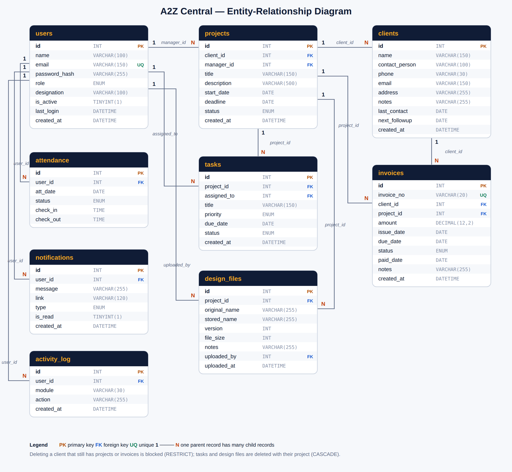

# A2Z Central — Database Design

Database: **a2z_central** (MySQL / MariaDB, InnoDB, utf8mb4) · **9 tables · 74 columns · 11 foreign-key relationships**
Source of truth: `database/schema.sql` (tables are created by `setup.php`).

## 1. Entity-Relationship diagram



(`er_diagram.svg` is the same diagram as a scalable vector. In phpMyAdmin you can also open the database → **Designer** to see the live diagram.)

## 2. Tables at a glance

| # | Table | Purpose | Columns | Links to |
|---|-------|---------|--------:|----------|
| 1 | `users` | People who can sign in (administrators and staff). | 9 | — |
| 2 | `clients` | Companies / people the firm works for. | 10 | — |
| 3 | `projects` | Engineering projects. Each belongs to one client. | 9 | clients, users |
| 4 | `tasks` | Work items of a project (the cards on the task board). | 8 | projects, users |
| 5 | `invoices` | Bills sent to clients (admin only). | 11 | clients, projects |
| 6 | `attendance` | Daily attendance of staff. One row per person per day. | 6 | users |
| 7 | `design_files` | Uploaded design files with version history. | 9 | projects, users |
| 8 | `notifications` | Messages shown under the bell icon. | 7 | users |
| 9 | `activity_log` | Audit trail of what users did. | 5 | users |

## 3. Relationships (foreign keys)

| Parent (1) | Child (N) | Foreign key | If the parent is deleted | Meaning |
|---|---|---|---|---|
| `clients` | `projects` | `client_id` | blocked (RESTRICT) | A client can have many projects |
| `users` | `projects` | `manager_id` | link set to NULL | A user can manage many projects |
| `projects` | `tasks` | `project_id` | children deleted (CASCADE) | A project has many tasks |
| `users` | `tasks` | `assigned_to` | link set to NULL | A user can be assigned many tasks |
| `clients` | `invoices` | `client_id` | blocked (RESTRICT) | A client receives many invoices |
| `projects` | `invoices` | `project_id` | link set to NULL | An invoice may relate to one project |
| `users` | `attendance` | `user_id` | children deleted (CASCADE) | A user has one attendance row per day |
| `projects` | `design_files` | `project_id` | children deleted (CASCADE) | A project has many files and versions |
| `users` | `design_files` | `uploaded_by` | link set to NULL | A user uploads many files |
| `users` | `notifications` | `user_id` | children deleted (CASCADE) | A user receives many notifications |
| `users` | `activity_log` | `user_id` | link set to NULL | A user leaves many log entries |

Reading the table: *one* parent row is linked to *many* child rows. Example: one `clients` row → many `projects` rows through `projects.client_id`.

## 4. Design decisions (for the viva)

* **Normalization (up to 3NF):** every fact is stored once. An invoice stores `client_id`, not the client's name; a task stores `project_id` and `assigned_to`, not names. To show names we use a `JOIN`.
* **Primary keys:** every table has an auto-increment `id`.
* **Foreign keys protect the data:** a client who still has projects or invoices cannot be deleted (`RESTRICT`); deleting a project also deletes its tasks and file records (`CASCADE`); deleting a user keeps their projects/tasks but clears the link (`SET NULL`).
* **Unique constraints:** `users.email`, `invoices.invoice_no`, and `attendance (user_id, att_date)`: only one attendance row per person per day.
* **ENUM columns** (`role`, `status`, `priority`, …) allow only valid values.
* **Money** is `DECIMAL(12,2)` (never FLOAT) so amounts are exact.
* **Passwords** are stored only as bcrypt hashes in `users.password_hash`.
* **File versions:** `design_files.version` = highest existing version of the same name in the same project + 1; files are stored under a random `stored_name`.
* **Separate log tables:** `notifications` (what users see) and `activity_log` (audit trail) keep history without cluttering business tables.

## 5. Example query (JOIN across tables)

```sql
SELECT i.invoice_no, c.name AS client, p.title AS project, i.amount, i.status
FROM invoices i
JOIN clients c ON c.id = i.client_id
LEFT JOIN projects p ON p.id = i.project_id
WHERE i.status <> 'Paid' AND i.due_date < CURDATE();
```

## 6. Data dictionary

### `users`

People who can sign in (administrators and staff).

| Column | Type | Key | Null | Default | Meaning |
|--------|------|-----|------|---------|---------|
| `id` | INT | PK | NO | auto | Unique user number |
| `name` | VARCHAR(100) | — | NO | — | Full name |
| `email` | VARCHAR(150) | UNIQUE | NO | — | Sign-in email (unique) |
| `password_hash` | VARCHAR(255) | — | NO | — | bcrypt hash of the password (the real password is never stored) |
| `role` | ENUM | — | NO | 'staff' | 'admin' sees everything, 'staff' sees a limited view |
| `designation` | VARCHAR(100) | — | yes | NULL | Job title |
| `is_active` | TINYINT(1) | — | NO | 1 | 1 = can sign in, 0 = disabled |
| `last_login` | DATETIME | — | yes | NULL | Time of the last sign-in |
| `created_at` | DATETIME | — | NO | CURRENT_TIMESTAMP | When the account was created |

### `clients`

Companies / people the firm works for.

| Column | Type | Key | Null | Default | Meaning |
|--------|------|-----|------|---------|---------|
| `id` | INT | PK | NO | auto | Unique client number |
| `name` | VARCHAR(150) | — | NO | — | Company or client name |
| `contact_person` | VARCHAR(100) | — | yes | NULL | Person to talk to |
| `phone` | VARCHAR(30) | — | yes | NULL | Phone number |
| `email` | VARCHAR(150) | — | yes | NULL | Email address |
| `address` | VARCHAR(255) | — | yes | NULL | Address |
| `notes` | VARCHAR(255) | — | yes | NULL | Free note |
| `last_contact` | DATE | — | yes | NULL | Date of the last contact |
| `next_followup` | DATE | — | yes | NULL | Date to contact again (drives the follow-up colour) |
| `created_at` | DATETIME | — | NO | CURRENT_TIMESTAMP | When the record was created |

### `projects`

Engineering projects. Each belongs to one client.

| Column | Type | Key | Null | Default | Meaning |
|--------|------|-----|------|---------|---------|
| `id` | INT | PK | NO | auto | Unique project number |
| `client_id` | INT | FK → clients.id | NO | — | The client who owns the project |
| `manager_id` | INT | FK → users.id | yes | NULL | The user managing the project |
| `title` | VARCHAR(150) | — | NO | — | Project title |
| `description` | VARCHAR(500) | — | yes | NULL | Short description |
| `start_date` | DATE | — | yes | NULL | Planned start |
| `deadline` | DATE | — | yes | NULL | Deadline |
| `status` | ENUM | — | NO | 'Planning' | Planning / In Progress / On Hold / Completed |
| `created_at` | DATETIME | — | NO | CURRENT_TIMESTAMP | When the record was created |

### `tasks`

Work items of a project (the cards on the task board).

| Column | Type | Key | Null | Default | Meaning |
|--------|------|-----|------|---------|---------|
| `id` | INT | PK | NO | auto | Unique task number |
| `project_id` | INT | FK → projects.id | NO | — | The project the task belongs to |
| `assigned_to` | INT | FK → users.id | yes | NULL | The user responsible |
| `title` | VARCHAR(150) | — | NO | — | Task title |
| `priority` | ENUM | — | NO | 'Medium' | Low / Medium / High |
| `due_date` | DATE | — | yes | NULL | Due date |
| `status` | ENUM | — | NO | 'To | To Do / In Progress / Done (the board column) |
| `created_at` | DATETIME | — | NO | CURRENT_TIMESTAMP | When the task was created |

### `invoices`

Bills sent to clients (admin only).

| Column | Type | Key | Null | Default | Meaning |
|--------|------|-----|------|---------|---------|
| `id` | INT | PK | NO | auto | Unique invoice number (internal) |
| `invoice_no` | VARCHAR(20) | UNIQUE | yes | NULL | Readable number such as INV-0007 (set right after the insert) |
| `client_id` | INT | FK → clients.id | NO | — | The client being billed |
| `project_id` | INT | FK → projects.id | yes | NULL | Related project (optional) |
| `amount` | DECIMAL(12,2) | — | NO | — | Amount in taka |
| `issue_date` | DATE | — | NO | — | Date issued |
| `due_date` | DATE | — | NO | — | Date payment is due |
| `status` | ENUM | — | NO | 'Pending' | Pending / Paid / Overdue |
| `paid_date` | DATE | — | yes | NULL | Date the payment arrived |
| `notes` | VARCHAR(255) | — | yes | NULL | Free note |
| `created_at` | DATETIME | — | NO | CURRENT_TIMESTAMP | When the record was created |

### `attendance`

Daily attendance of staff. One row per person per day.

| Column | Type | Key | Null | Default | Meaning |
|--------|------|-----|------|---------|---------|
| `id` | INT | PK | NO | auto | Unique record number |
| `user_id` | INT | FK → users.id | NO | — | The person |
| `att_date` | DATE | — | NO | — | The day |
| `status` | ENUM | — | NO | 'Present' | Present / Late / Absent / Leave |
| `check_in` | TIME | — | yes | NULL | Time checked in |
| `check_out` | TIME | — | yes | NULL | Time checked out |

Composite UNIQUE key: (user_id, att_date).

### `design_files`

Uploaded design files with version history.

| Column | Type | Key | Null | Default | Meaning |
|--------|------|-----|------|---------|---------|
| `id` | INT | PK | NO | auto | Unique file record number |
| `project_id` | INT | FK → projects.id | NO | — | The project the file belongs to |
| `original_name` | VARCHAR(255) | — | NO | — | Name of the uploaded file |
| `stored_name` | VARCHAR(255) | — | NO | — | Random name used on disk (cannot be guessed) |
| `version` | INT | — | NO | 1 | 1, 2, 3 ... (next version = highest + 1 for the same name in the same project) |
| `file_size` | INT | — | NO | 0 | Size in bytes |
| `notes` | VARCHAR(255) | — | yes | NULL | Version note |
| `uploaded_by` | INT | FK → users.id | yes | NULL | Who uploaded it |
| `uploaded_at` | DATETIME | — | NO | CURRENT_TIMESTAMP | Upload time |

### `notifications`

Messages shown under the bell icon.

| Column | Type | Key | Null | Default | Meaning |
|--------|------|-----|------|---------|---------|
| `id` | INT | PK | NO | auto | Unique notification number |
| `user_id` | INT | FK → users.id | NO | — | Who receives it |
| `message` | VARCHAR(255) | — | NO | — | Text shown to the user |
| `link` | VARCHAR(120) | — | yes | NULL | Page to open when clicked |
| `type` | ENUM | — | NO | 'info' | info / reminder / success / warning |
| `is_read` | TINYINT(1) | — | NO | 0 | 0 = new, 1 = read |
| `created_at` | DATETIME | — | NO | CURRENT_TIMESTAMP | When it was created |

### `activity_log`

Audit trail of what users did.

| Column | Type | Key | Null | Default | Meaning |
|--------|------|-----|------|---------|---------|
| `id` | INT | PK | NO | auto | Unique entry number |
| `user_id` | INT | FK → users.id | yes | NULL | Who did it |
| `module` | VARCHAR(30) | — | NO | — | Which part of the system |
| `action` | VARCHAR(255) | — | NO | — | What happened (text) |
| `created_at` | DATETIME | — | NO | CURRENT_TIMESTAMP | When it happened |


## 7. সংক্ষেপে বাংলায়

* ডাটাবেসের নাম `a2z_central`; **9টা table**, এগুলোর মধ্যে **11টা সম্পর্ক** (foreign key)।
* `clients` → `projects` → `tasks`: একজন client-এর অনেক project, একটা project-এর অনেক task।
* `invoices` যুক্ত `clients` ও `projects`-এর সাথে; `design_files` যুক্ত `projects` ও `users`-এর সাথে (version সহ)।
* `users` থেকে `attendance`, `tasks`, `notifications`, `activity_log` যুক্ত।
* তথ্য একবারই রাখা হয় (normalization), তাই invoice-এ client-এর নাম নয় `client_id` থাকে।
* Client-এর project/invoice থাকলে client মোছা যায় না (`RESTRICT`); project মুছলে তার task ও file-রেকর্ড মুছে যায় (`CASCADE`)।
